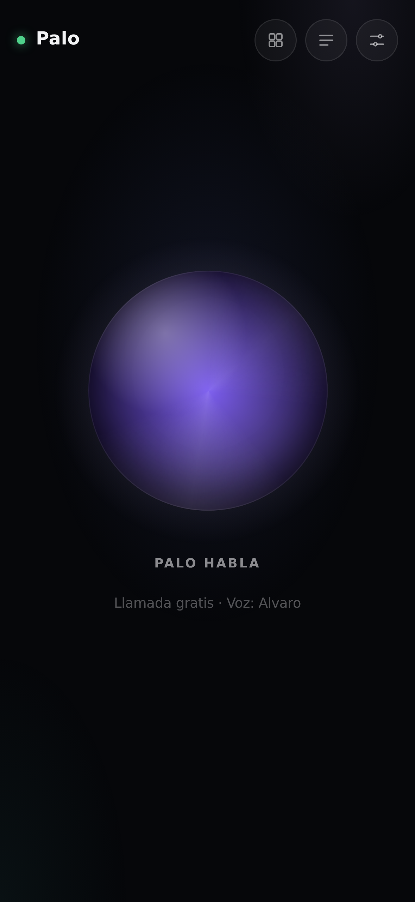
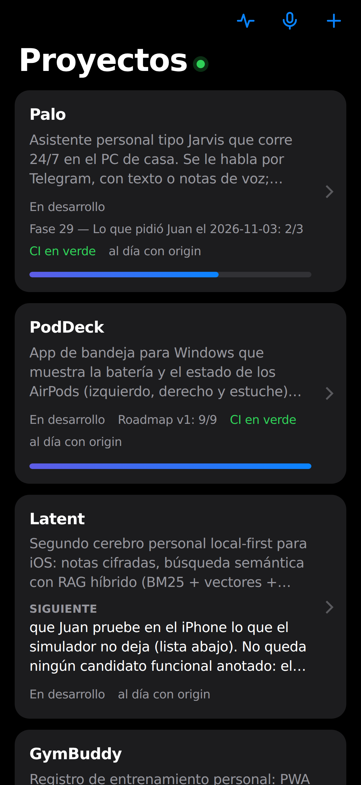
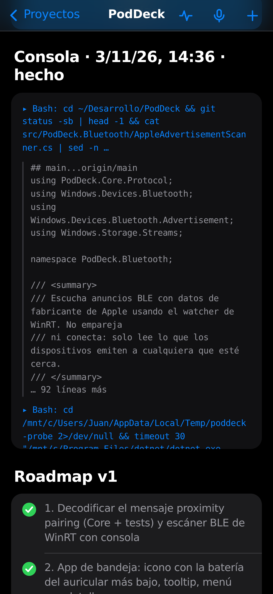
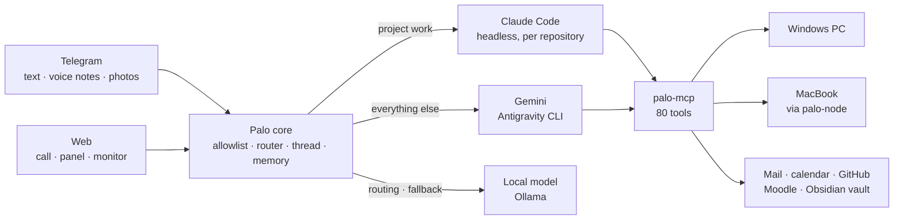
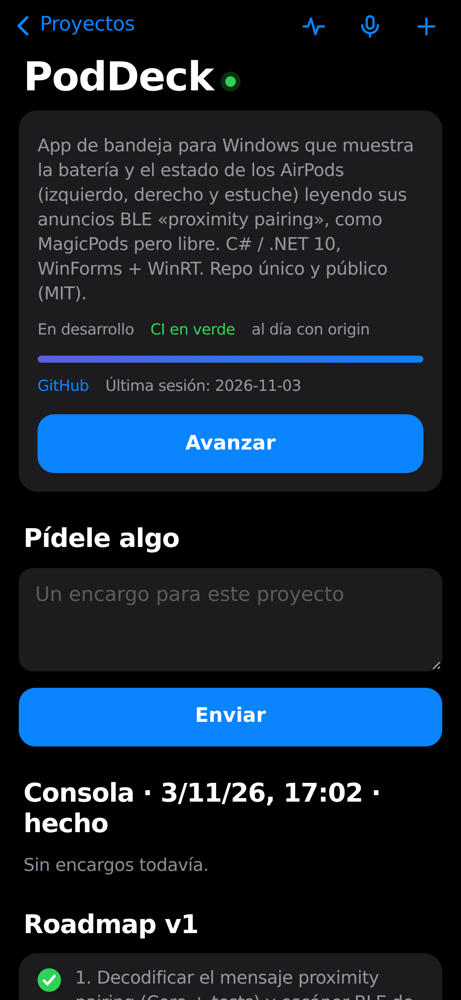
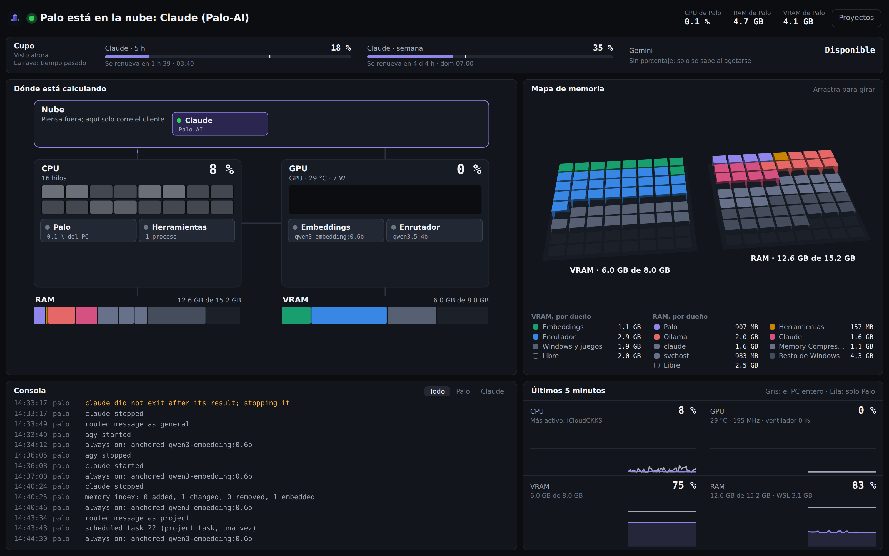

# Palo

**A self-hosted, Jarvis-style personal assistant that lives on a home PC, reaches into a laptop, and
gets real work done by driving the AI subscriptions its owner already pays for.**

You talk to Palo on Telegram, in text or voice notes, the way you would message a person. No
commands. Behind that single conversation it decides who should answer: Claude Code working
headless inside one of dozens of repositories, Gemini for everything else, or a small local model.
It remembers what matters without being told to, keeps an eye on email, calendar, CI and
university deadlines, and acts on two computers: the Windows desktop it lives on and a MacBook it
drives through a daemon of its own. A web page turns the same assistant into a phone call.

  
  &nbsp;
  
  &nbsp;
  

> This repository is Palo's showcase: documentation and media only. The source code lives in a
> private repository; everything described here is running every day.

## Contents

- [What it does](#what-it-does)
- [One assistant, three brains](#one-assistant-three-brains)
- [Two computers, one memory](#two-computers-one-memory)
- [Talking to it](#talking-to-it)
- [The monitor](#the-monitor)
- [Working on its own](#working-on-its-own)
- [Constraints it was built under](#constraints-it-was-built-under)
- [By the numbers](#by-the-numbers)
- [Documentation](#documentation)

## What it does

- **Software projects, from the phone.** "The search tests in Latent are failing, take a look"
  switches to that repository and starts Claude Code in it. One Telegram message shows each step
  live, risky actions come back as *Allow / No* buttons, and the report ends with the new commits.
  "Keep going with Latent" hands Claude the project's progress prompt, so a run of several
  increments starts like a fresh agent session. Several projects run in parallel, the rest queue.
- **Everyday assistant.** Mail across every account (searched at once), the iCloud calendar,
  reminders and timed jobs, notes in an Obsidian vault, the university's Moodle, web pages it was
  asked to watch, and the PC itself: open an app or a game by name, take a screenshot, send a file,
  turn the volume down.
- **A memory that does not need to be fed.** After each exchange Palo decides whether something
  durable was said and stores it as a note, announcing it in one line. "Forget that" removes it.
  Recall is semantic and hybrid, over a local index.
- **Voice, both ways.** Voice notes are transcribed on the PC and answered with a voice note when
  the answer can be spoken. A web page offers a hands-free call with barge-in.
- **It speaks first.** A spoken morning briefing, a red CI as soon as it goes red, a new grade the
  moment it is published, a deadline that collides with an exam, a reminder delivered when its
  owner gets home.
- **It fixes things at night.** Between 02:00 and 06:00 it checks every repository without a model
  and wakes Claude only for what is red. The fix reaches `main` only if the tests pass.

The full list, area by area, is in [docs/capabilities.md](docs/capabilities.md).

## One assistant, three brains

Every message goes through a small local model first. It classifies the intent (`project`,
`general` or `trivial`) using the active project, the names of every repository and the previous
exchange, and picks an engine:

- **Claude Code** for anything that touches a repository. It is the scarce resource: one
  subscription with five-hour and weekly windows, shared with the owner's own sessions on the
  laptop. Palo reads the usage from the CLI's own rate-limit events, asks before launching work
  near the limit, offers to run it when the window resets, and stops cleanly mid-task.
- **Gemini**, through Google's Antigravity CLI, for questions, mail, calendar, notes and driving
  the PC. It falls back to Claude and then to the local model when it is down or out of quota.
- **The local model** routes, summarises old turns, reads watched pages and checks images, and is
  the last resort when nothing else answers.

The engines wrap each CLI as a subprocess and turn its `stream-json` output into one common event
stream, so the core never knows which model is underneath. The thread belongs to Palo, not to an
engine: one SQLite history is shared by the three of them. More in
[docs/how-it-works.md](docs/how-it-works.md).

## Two computers, one memory

Palo runs around the clock on a Windows desktop, inside WSL2. Its owner mostly works on a MacBook.
Both machines are part of the same assistant:

- **The Mac is a pair of hands.** [palo-node](docs/machines.md#palo-node), a small Go daemon,
  runs as a LaunchAgent in the owner's macOS session, so it holds the privacy permissions granted
  once (screen recording, accessibility). Palo can run shell commands there, take screenshots,
  open apps and links, read and write the clipboard, move files in both directions and drive the
  iOS Simulator. It listens only on the private Tailscale network and checks a token on every
  request. A sleeping laptop is reported in one sentence, never retried behind anyone's back.
- **The memory is shared.** Palo's long-term memory is an Obsidian vault that is also the private
  git repository holding the owner's coding-agent instructions, memories, skills, templates and the
  agent files of every project. What Palo learns over Telegram reaches Claude Code on the laptop,
  and what is learnt on the laptop reaches Palo, through a sync that runs every 15 minutes.
- **Every command is logged** with the machine it ran on, whether or not the model mentions it.

Details in [docs/machines.md](docs/machines.md) and [docs/memory.md](docs/memory.md).

## Talking to it

### Telegram

The main interface: text, voice notes, photos and albums, with buttons for approvals and for
Claude's questions. Voice notes are transcribed locally with faster-whisper; an answer that can be
spoken (no code, links or long lists) comes back as a voice note, and a long project report is
followed by a short spoken summary.

### The call

  
  &nbsp;
  
  &nbsp;
  

A web page, installable on the phone, where you talk to Palo hands-free and can cut it off
mid-sentence. It is the same Palo: same instructions, memories, recent thread and tools, and every
sentence lands in the shared thread, so Telegram knows what was said. Two modes:

- **Free**, the default: the page gates the microphone against the background noise and uploads
  one clip per turn; Palo transcribes it, feeds one long-lived Gemini process kept warm for the
  whole call, and streams each finished sentence back as speech while the rest is still being
  written.
- **Instant**, opt-in: OpenAI's Realtime API over WebRTC, with semantic turn detection. Palo fixes
  the whole session server-side and hands the browser an ephemeral key, so the page can only talk.
  Tool calls arrive on the data channel and run in Palo through the same MCP server the CLIs use.

Anything that notifies someone else (sending an email, inviting guests, deleting an event) shows a
card with its exact arguments and runs only if approved. Sign-in is a passkey: Face ID on the
phone, Touch ID on the laptop. More in [docs/voice-and-web.md](docs/voice-and-web.md).

### The project panel

  
  &nbsp;
  
  &nbsp;
  

A card per project, assembled on request from what is already the source of truth: the vault note,
the current phase of its `PROGRESS.md`, recent commits, CI and what Palo is doing with it. An
*Advance* button, a field to give Claude a task or talk to the one already running, Claude's
console live, the queue, and a form that turns a new idea into a bootstrapped repository. Nothing
is copied: every action calls the same methods Telegram does.

## The monitor

Palo runs hidden inside WSL, so a loud fan left an open question. The monitor is a window on the
Windows desktop that answers it:

- **Quota.** Claude's five-hour and weekly windows, each with a tick for how much of the window has
  gone by, so spending ahead of the clock is obvious. Gemini publishes no percentage, so the monitor
  shows none.
- **Where it is computing.** One chip per workload (router, embeddings, Whisper, Claude, Gemini,
  the call) sitting in the CPU, the GPU or the cloud. When Palo steps aside for a game, its chips
  fly from the GPU to the CPU.
- **Memory in 3D.** VRAM and RAM as two plates of blocks coloured by owner. Palo gets colours and
  everything else stays grey, so a game shows up as a grey district next to what Palo holds.
- **Console and history.** Palo's log and Claude's commands side by side with five minutes of the
  whole machine against Palo's own share.

It measures nothing unless someone is looking, and the 3D map is a 2D canvas at 15 frames per
second, because a monitor should not take GPU from the game it is watching.

## Working on its own

- **Night watch.** Every project in progress is checked between 02:00 and 06:00 with its own toolchain (pytest, ruff, mypy, `go test`, `npm test`) and its last CI run. Claude is woken only for what is red, one narrow task per repository, under a stricter quota gate.
- **Isolated tasks.** When a checkout has unfinished work, a task runs in a throwaway `git worktree`. Palo runs the checks itself; green work is rebased and pushed, red work never reaches `main`.
- **Looking ahead.** Every 30 minutes the calendar, pending university work and red CI are put side by side. Rules catch the facts; Gemini judges the rest and must cite two facts from different sources.
- **Promises.** "I'll look into it in ten minutes" becomes a scheduled task. A quote check makes sure the promise was really made.
- **Self-checks.** Every image Palo produces is measured and shown to the local vision model before it is sent, and every README image is checked before a push.
- **Getting home.** Noticed from the home Wi-Fi with no app on the phone; what was left "for when I get home" is delivered then.
- **Safety net.** An encrypted daily backup of its state, and a heartbeat to a free Cloudflare Worker that messages the owner if Palo goes quiet for 15 minutes.

## Constraints it was built under

The interesting part is not any single feature but the rules it had to respect, each recorded as an
architecture decision (24 so far, summarised in [docs/decisions.md](docs/decisions.md)):

- **Subscriptions, not API keys.** Every model is reached through its official CLI with a personal
  subscription, or locally through Ollama. The one paid exception, the instant call, is opt-in.
- **One consumer GPU, shared with games.** The router is a 4B model picked by a reproducible bench
  over real phrases (54/54). Whisper loads on demand, and when something else wants the GPU, Palo
  unloads everything and carries on from the CPU until it is calm again.
- **Zero inbound surface.** Telegram long polling with an allowlist, maintenance over Tailscale,
  the web behind a tunnel with its own access layer.
- **Full control, fully logged.** The models can run any command on both machines without asking:
  that is the owner's explicit choice. Every command lands in a log, unexpected access is reported
  at once, and a weekly review lists what the PC exposes.
- **Nothing the model can be talked into.** Sending mail or inviting people is denied to the model,
  asked for with a button, and then executed by Palo itself with exactly the approved arguments.

## By the numbers

As of November 2026, three weeks after the first commit:

- **775 commits** in the private repository, from the first one on 14 October 2026.
- **About 35,000 lines of Python** and 4,400 of HTML, CSS and JavaScript for the web, plus
  6,500 lines of Go in palo-node.
- **2,867 tests**, run with mypy `--strict` and ruff on every push. The suite never touches the
  network or a real CLI: fake `claude` and `agy` executables replay recorded output.
- **80 MCP tools**, used by Claude, Gemini and both kinds of call.
- **24 architecture decision records.**

## Documentation

- **[How it works](docs/how-it-works.md)** — the path of a message through allowlist, routing, prompt assembly, engines, approvals, the memory keeper
- **[Capabilities](docs/capabilities.md)** — everything Palo can do, area by area, with the tools behind it
- **[Two computers](docs/machines.md)** — the PC, the Mac, palo-node and the shared context
- **[Memory](docs/memory.md)** — the Obsidian vault, automatic memory, hybrid recall and the graph
- **[Voice and web](docs/voice-and-web.md)** — voice notes, the free and the instant call, the panel, the monitor, passkeys
- **[Security](docs/security.md)** — what Palo exposes, what it watches and what it never lets a model do
- **[Decisions](docs/decisions.md)** — the 24 architecture decisions, one paragraph each

---

Built by [Juan Martos Cuevas](https://github.com/juanmmm21). Licensed under [MIT](LICENSE) (the
documentation and media in this repository).
