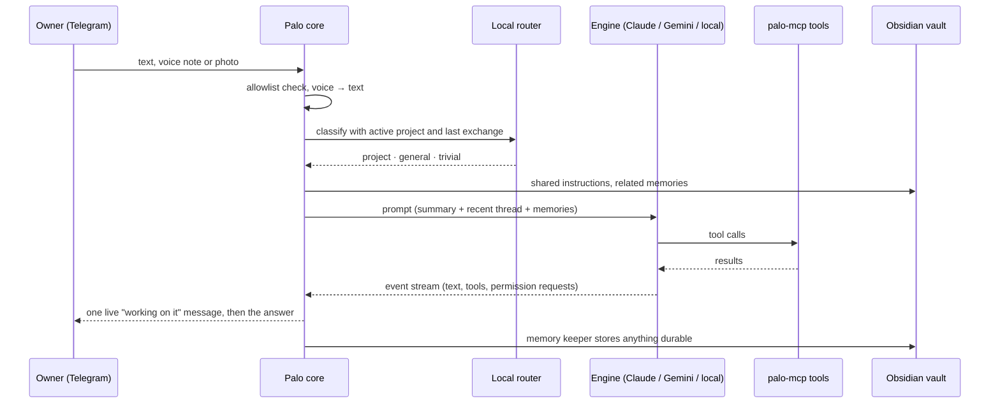

# How it works

The path of one message, from the phone to an answer, and what keeps running in the background.

## The path of a message

1. **It arrives.** Telegram is read by long polling, so nothing listens on the internet. Anyone
   outside an allowlist of user ids is ignored without a reply. Voice notes are transcribed on the
   GPU first; a photo is saved and its path travels with the request, because the CLIs do not take
   images inside a text task. An album arrives as one message.
2. **It is routed.** A 4B model in Ollama classifies the message as `project`, `general` or
   `trivial`, taking into account the active project, the names of every repository and the
   previous exchange. Project work that names another repository switches to it first, cloning it
   if needed. Only what the owner wrote is interpreted: a caption, never a file path that happens to
   contain a project's name.
3. **The prompt is assembled** from the shared instructions in the vault, a local summary of older
   turns (they are summarised, never dropped), the recent history and the memories that relate to
   the message.
4. **The engine runs as a subprocess.** Each CLI's `stream-json` output becomes one common stream
   of events (text, tool calls, results, permission requests, quota errors). Those events update a
   single message in Telegram while the work happens.
5. **Permissions become buttons.** When a model hits something outside its allowlist (a force push,
   deleting files outside the repository), the request comes back as *Allow / No*. On approval Palo
   either resumes the session with that permission or runs the approved call itself.
6. **The answer** is Markdown rendered to Telegram's HTML. If the request came in as voice and the
   answer can be spoken, it goes back as a voice note.
7. **The memory keeper** asks whether the exchange said anything durable, checks that the owner
   really said it, and stores it in the vault, announcing it in one line.

## Engines

Every model is reached through its official CLI with a personal subscription, or locally:

- **Claude Code** (`claude -p --output-format stream-json`) for project work. Sessions are resumed
  per project with `--resume`, so "and now the tests" continues the same conversation. Project
  sessions keep standard input open, so a message sent while Claude is working ("tell Claude to
  skip the docs") is written straight into the live session.
- **Gemini through Antigravity** (`agy`) for everything else. During a call one `agy` process is
  kept warm for the whole conversation, because starting the CLI for every sentence takes several
  seconds.
- **Ollama** for routing, summaries, page watching, the memory keeper's fallback, image checks and
  the last-resort answer.

A fallback chain moves from one engine to the next when one fails or runs out of quota. An engine
that is out is skipped until it is back, and Palo says when it is.

### The quota

Claude's subscription has a five-hour window and a weekly cap, and the same account is used from
the laptop. Palo reads the usage from the CLI's own rate-limit events, refreshing it with the
smallest possible call when the figure is stale. Near the limit it asks before starting project
work and offers to run it when the window resets; mid-task it stops cleanly and resumes after the
reset. When the window renews with work waiting, it says so.

## Project work

- **Parallel and queued.** Different projects run at the same time up to a cap; a second request
  for a busy project waits in a queue that can be reordered in plain words ("do the Latent one
  first"). The queue and what was running are saved on every change and restored after a restart.
- **Progress prompts.** "Keep going with X" hands Claude the progress prompt stored in that
  project's vault note, so a long run starts like a fresh agent session with everything it needs.
- **Claude can ask.** Project sessions have an `ask_juan` tool. The question is stored, Claude ends
  its turn, the slot is freed, and the answer (a button on Telegram or in the panel) resumes that
  very session.
- **Work for other projects is handed over.** If a request in one project's session belongs to
  another one, it is passed to that project instead of being refused.
- **Isolated when needed.** If the owner's checkout has uncommitted or unpushed work, the task runs
  in a throwaway `git worktree` cut from a fresh `origin`. Claude commits there without pushing;
  Palo runs the repository's own checks, rebases green work onto `origin`, checks again and pushes
  without force. Red work, conflicts or a commit with a foreign author never reach `main`.
- **A live window on the PC.** A terminal opens with the session as it happens: Claude's text,
  every tool call and the output of each command.

## In the background

`palo run` is one process with several loops besides the chat:

- **Scheduler.** One-off, daily, weekday and weekly tasks that survive restarts: reminders, timed
  requests, promises Palo made, a nightly project summary written into the day's note.
- **Morning briefing.** Spoken, with the day's calendar, important unread mail, red CI and a joke.
- **CI watch.** The last run of every repository; red is told once, and so is green again.
- **Grades and practices.** New or changed grades on the university's Moodle, told once; lab
  practices copied into the vault with their files and a requirements checklist cited from the
  statement.
- **Watched pages.** The local model extracts the price or date that matters and Palo speaks only
  when it changes.
- **Looking ahead.** Calendar, pending coursework and red CI crossed every 30 minutes.
- **Ideas against code.** Open ideas and notes lined up against what has already been built, at
  most one suggestion a day.
- **Night watch.** The nightly round over every repository, with a morning report only when there
  is something to tell.
- **Security.** Alerts for unexpected access and a weekly review.
- **Vault sync.** Every 15 minutes with the other machine.
- **Heartbeat and backup.** A beat to an external watchdog every five minutes and an encrypted
  backup once a day.

Each loop can be turned off on its own, and a source that fails only leaves its own facts out.

## Testing

The test suite never touches the network or a real CLI. Fake `claude` and `agy` executables replay
`stream-json` recorded from the real tools on the PC; IMAP, SMTP, CalDAV, PowerShell, the Mac
daemon and Moodle have in-process fakes, and a test fails if anything opens a socket. Type checking
runs with mypy `--strict` on both macOS and Linux targets, and CI runs everything on every push.
