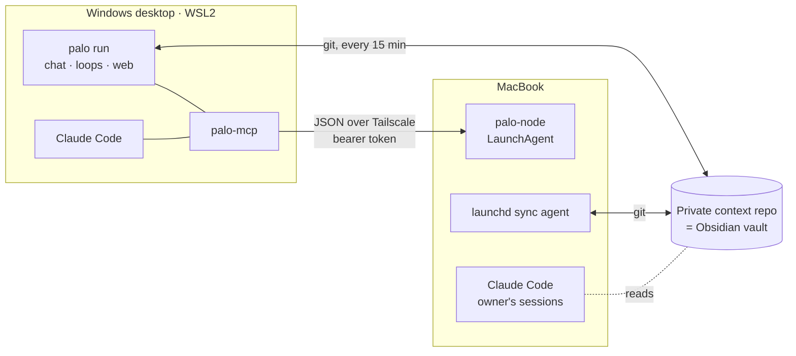

# Two computers

Palo lives on one machine and works on two. The owner mostly codes on a MacBook; the assistant
runs on the Windows desktop at home, where it can stay on around the clock.

## The PC

Palo runs inside WSL2 as a systemd user service that restarts on any exit and survives reboots.
From there it reaches Windows through interop: PowerShell for the desktop, `nvidia-smi` for the GPU,
the Start menu and Steam for apps and games. Maintenance happens over Tailscale SSH from the laptop.

The GPU belongs to the owner first. With everything loaded Palo holds about two thirds of it, and
most of that lets go by itself: Ollama drops models after five idle minutes and Whisper loads on
demand. Every 20 seconds Palo looks at the whole card; if it stays busy or nearly full for a minute,
something else wants it, whether a game or a render. Palo unloads all its models and carries on from
the CPU with four threads, then goes back after three calm minutes. A marker file tells the separate
MCP process to follow along.

## palo-node

The laptop is reached through palo-node, a small daemon written in Go for this purpose:

- **It runs in the owner's session.** A LaunchAgent, not an SSH login, so it holds the macOS
  privacy permissions granted once (screen recording, accessibility). A command sent over SSH would
  not be allowed to take a screenshot or drive an app.
- **It listens only on the Mac's Tailscale address** and checks a bearer token on every request.
  Nothing is exposed on the local network or the internet.
- **JSON over HTTP.** Two programs written by the same person, a dozen calls and one client: no
  code generation needed, and everything can be tried with `curl`. Long commands stream their output
  back as NDJSON while they run.
- **Few capabilities, done well.** Status, free shell commands, screenshots, opening apps and links,
  notifications, the clipboard, files in both directions and the iOS Simulator. They come from the
  Mac's own commands (`screencapture`, `osascript`, `open`, `pbcopy`, `xcrun simctl`), which is why
  Go was enough: it cross-compiles from the PC and is tested on Linux, so Palo can maintain its own
  daemon without Xcode.
- **A laptop sleeps.** If the Mac does not answer within five seconds, the tool says so in one
  sentence. Nothing is retried or queued behind the owner's back.

Every command lands in the same log as the PC's, tagged with the machine it ran on.

## One shared context

Claude Code on the laptop has years of accumulated context: global instructions, memories,
skills, templates, and the agent files of every project, which are git-ignored on purpose so they
never reach public repositories. A clone on the PC would arrive without any of it.

So that context lives in its own private repository, with the same layout on both machines, and
`palo context sync` keeps it in step: pull with rebase, copy each file to its real place, collect
local changes, commit and push. It runs before and after every Claude session on the PC, every
15 minutes in `palo run`, and from a launchd agent on the Mac. The memory folder's name encodes an
absolute path, which differs between macOS and Linux; the sync translates it. A conflict is never
resolved silently: the sync stops and Palo says so.

That repository is also the Obsidian vault and Palo's long-term memory (see
[memory.md](memory.md)). There is one memory, not two that drift apart.
