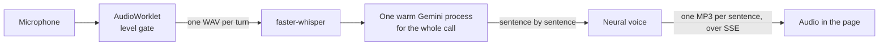
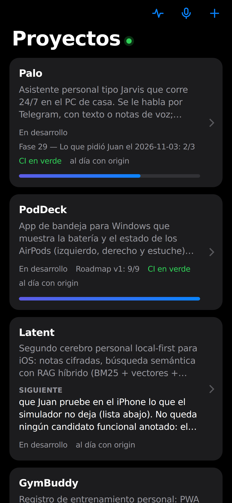
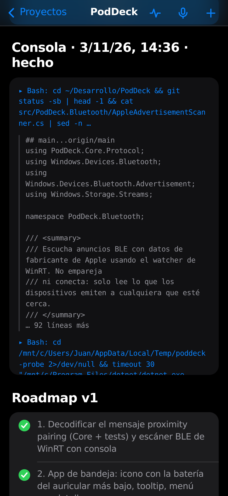
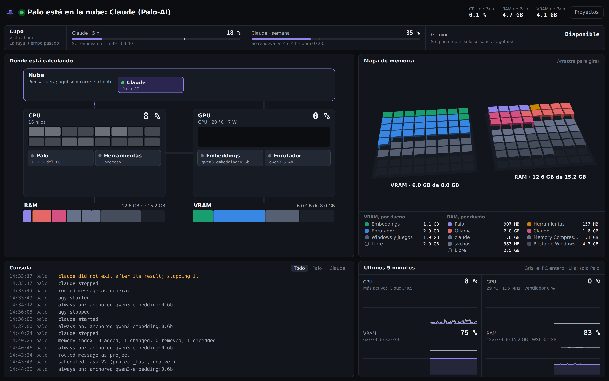

# Voice and web

## Voice notes

A voice note on Telegram is transcribed on the PC with faster-whisper. If the answer can be spoken
(no code, links or long lists), it comes back as a voice note in a neural Spanish voice; otherwise
it comes back in writing. A long project report arrives in writing, followed by a short voice note
in which the local model sums it up.

## The call

A small web page, served by Palo itself and installable on the phone, where you talk to Palo
hands-free and can interrupt it, like the voice mode of a chat app.

  
  &nbsp;
  
  &nbsp;
  

It is the same Palo: the vault's instructions plus voice-specific rules, the date and time, the
memory index with the related memories, the thread summary and the last turns from Telegram. Every
tool is available, every tool call is listed in the on-screen transcript, and anything that notifies
someone else shows a card with its exact arguments and runs only if approved.

### The free call

The default, at no cost:

1. The page watches the microphone level against the background noise, with a higher and longer
   bar while Palo speaks, so its own voice does not interrupt it.
2. Palo transcribes each turn and writes it into one long-lived Gemini process started when the
   call opens. Starting the CLI for every sentence would cost several seconds each time.
3. Each finished sentence is synthesised and streamed back at once, so the first one plays while
   Gemini is still writing the rest.
4. Speaking over Palo stops the audio and drops the turn. The CLI cannot cancel a turn, so its output
   is read to the end before the next one, and Gemini is told what was not heard.

### The instant call

Opt-in, and the one paid API in the whole system: OpenAI's Realtime API, for phone-call latency,
turn-taking and barge-in that a local pipeline on a shared consumer GPU cannot reach.

1. Tapping the orb opens the microphone and asks Palo for a session. Palo builds the instructions,
   lists every MCP tool as a function and requests an ephemeral key with the whole session fixed
   server-side: model, voice, transcription and semantic turn detection. The page cannot change any
   of it; it can only talk.
2. The browser connects over WebRTC. Audio never touches the PC.
3. Function calls arrive on the data channel; the page posts each one to Palo, which runs it in
   process through the same MCP server the CLIs use and sends the output back.
4. Each finished sentence is added to the shared thread right away. On hang-up, or after two silent
   minutes, the local model writes a one-line summary of the call, with the tools used, in the day's
   note.

Without an OpenAI key nothing changes: the page offers the free call only.

## The project panel

  
  &nbsp;
  
  &nbsp;
  

- **Nothing is copied.** A card is assembled on request from the vault note, the current phase of
  `PROGRESS.md`, git, recent commits and CI, and every action calls the same methods Telegram does:
  same queue, same quota check, same report in the chat.
- **Live.** Server-sent events say when something changed and carry the console of the running
  task: Claude's text, each command and its output.
- **Questions.** When Claude needs a decision mid-task, the question appears here and on Telegram;
  either answer resumes the session.
- **Short on quota?** The answer carries the choices (launch anyway, or when the window resets) and
  the page repeats the request with the one picked.
- **New ideas.** A name and a description start the usual bootstrap; the card then shows *repo
  missing* with a link to GitHub's form until the owner creates it.
- **Safe rendering.** No HTML is ever built from data: everything from Palo, and from Claude, enters
  the page as text, under a strict Content Security Policy.

## The monitor

A page of the same web, opened as an app window on the Windows desktop with its own shortcut, and
also usable from the phone.

- **Windows is measured by one long-lived PowerShell** that writes a JSON line every two seconds,
  using WMI classes that do not change with the system language.
- **WSL is read from `/proc`** without launching anything. A process with no known name counts for
  its ancestor, so the test run of a task is CPU spent by Claude.
- **A model working is inferred.** Ollama only gives it away by moving a model's expiry time, so a
  model is shown as active for a few seconds after that.
- **Memory is drawn by owner**, not by address, since Windows does not publish that map; what
  cannot be attributed is shown as "Windows and games".
- **It measures nothing unless someone is looking.** Sampling starts with the first window and stops
  with the last; a minimised window closes its stream. Claude's quota is refreshed only while a
  window is open, at most every 30 minutes, with the smallest query that makes the CLI report it.

## Signing in

The web is reached through a tunnel with its own access layer, and the pages ask for an access key
once. After that first sign-in they offer a passkey: Face ID on the phone or Touch ID on the laptop,
and since the passkey lives in the iCloud Keychain, registering it on one device is enough for both.
Only the public key is stored, ten wrong attempts in ten minutes lock the login, and changing the
access key deletes every passkey, which is how a lost device loses its way in.
