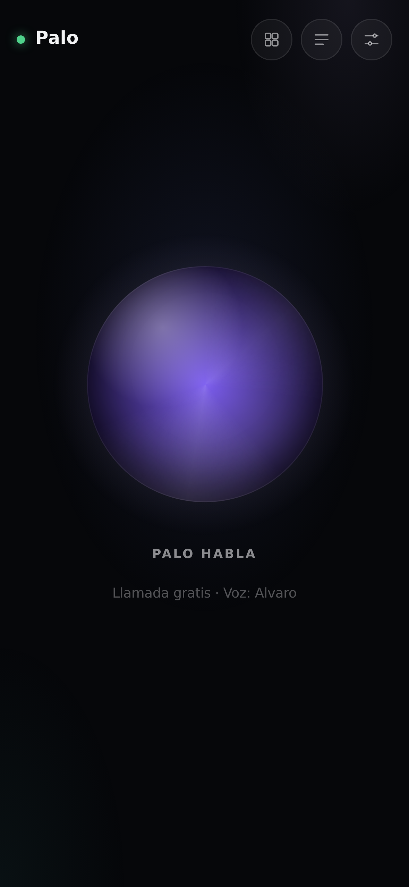
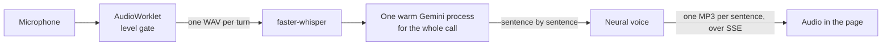
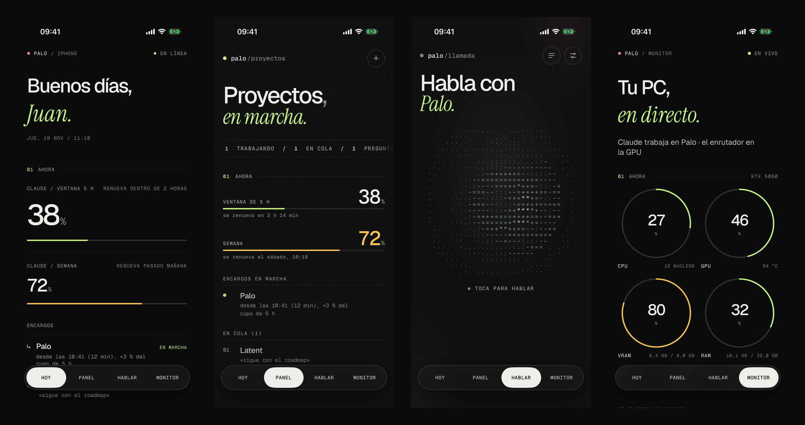
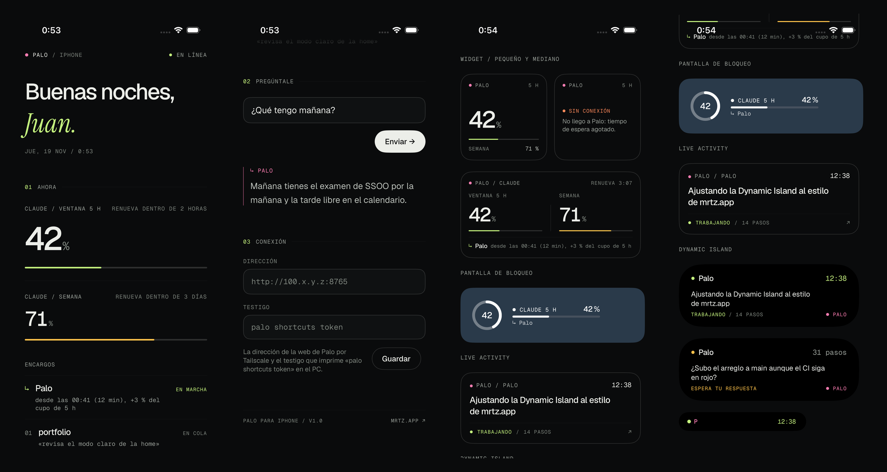
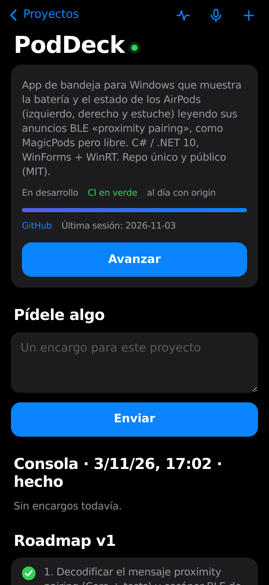

# Voice and web

## Voice notes

A voice note on Telegram is transcribed on the PC with faster-whisper. If the answer can be spoken
(no code, links or long lists), it comes back as a voice note in a neural Spanish voice; otherwise
it comes back in writing. A long project report arrives in writing, followed by a short voice note
in which the local model sums it up. The voice is a neural Spanish voice from Edge, with a local
model as a fallback. A local voice-cloning studio was tried on the shared 8 GB GPU in November, and
it was dropped because it either did not fit next to Whisper or took seconds per sentence.

## Writing on Telegram

- **Bursts become one message.** Text waits 2.5 seconds after the last message, at most 10 seconds
  from the first, and the burst gets a single answer, so the owner can write one idea per message.
- **The answer is visible while it is written,** as a live draft, and then sent as a normal message,
  so the phone's notification shows the answer itself.
- **Long work does not hold the chat.** A general turn that takes more than 30 seconds moves to the
  background with one line, and the conversation goes on.

## "Hey Palo"

A wake word on both computers, in `palo-ear`, a small Python program that stays open all the time.
It only gates the microphone by level and sends what sounds like speech to the PC. There a small
speech recogniser listens for "Hey Palo", and Whisper takes over whatever that misses: with the
laptop's real microphone the small recogniser missed every call, and Whisper caught almost all of
them in half a second each. What follows the wake word goes into the same conversation as everywhere
else, and anything that needs approval is asked for in writing, never approved by voice. On the Mac it has a face: a Swift menu-bar app that launches the ear, restarts it
if it falls over, and shows a bubble under the menu bar with what was said and what Palo answers,
without taking focus or clicks. Listening can be switched off, or limited to when the laptop is
charging.

## The call

A small web page, served by Palo itself and installable on the phone, where you talk to Palo
hands-free and can interrupt it, like the voice mode of a chat app.

  
  &nbsp;
  
  &nbsp;
  

It is the same Palo: the vault's instructions plus voice-specific rules, the date and time, the
memory index with the related memories, the thread summary and the last turns from Telegram. Every
tool is available, every tool call is listed in the on-screen transcript, and anything that notifies
someone else shows a card with its exact arguments and runs only if approved.

### The free call

The default, at no cost:

1. The page watches the microphone level against the background noise, with a higher and longer
   bar while Palo speaks, so its own voice does not interrupt it.
2. Palo transcribes each turn and writes it into one long-lived Gemini process started when the
   call opens. Starting the CLI for every sentence would cost several seconds each time.
3. Each finished sentence is synthesised and streamed back at once, so the first one plays while
   Gemini is still writing the rest.
4. Speaking over Palo stops the audio and drops the turn. The CLI cannot cancel a turn, so its output
   is read to the end before the next one, and Gemini is told what was not heard.

### The instant call

Opt-in, and the one paid API in the whole system: OpenAI's Realtime API, for phone-call latency,
turn-taking and barge-in that a local pipeline on a shared consumer GPU cannot reach.

1. Tapping the orb opens the microphone and asks Palo for a session. Palo builds the instructions,
   lists every MCP tool as a function and requests an ephemeral key with the whole session fixed
   server-side: model, voice, transcription and semantic turn detection. The page cannot change any
   of it; it can only talk.
2. The browser connects over WebRTC. Audio never touches the PC.
3. Function calls arrive on the data channel; the page posts each one to Palo, which runs it in
   process through the same MCP server the CLIs use and sends the output back.
4. Each finished sentence is added to the shared thread right away. On hang-up, or after two silent
   minutes, the local model writes a one-line summary of the call, with the tools used, in the day's
   note.

Without an OpenAI key nothing changes: the page offers the free call only.

## The iPhone app

  

A SwiftUI app for the owner only, outside the App Store, and the main way into Palo from the phone.
It has four tabs under a floating bar:

- **Today**, native: Claude's quota for the five-hour window and the week, and the work running and
  queued.
- **Panel** and **Talk**: the same web pages a computer opens, inside the app, with a device session
  of their own paired once from the web.
- **Monitor**, native and designed for a phone: CPU, GPU, VRAM and RAM as rings, live.

  

Next to the tabs are quota widgets and the Claude task in progress as a **Live Activity**, on the lock
screen and in the Dynamic Island. Palo starts it remotely when a task begins, so the app does not
need to be open. It updates it with what Claude is really doing, taken from the description Claude
writes for each command ("Fixing the step sync (2/5)"), closes it with a one-line result and removes
it 30 seconds later. Palo sends those pushes itself, with a minimal APNs client over HTTP/2 and a
provider token signed with the owner's key.

iOS Shortcuts reach the same API with a token that is valid only for Shortcuts: the Action button
asks Palo by voice, the share sheet sends a link, PDF or photo, and arriving home delivers what was
left for then. The app follows the visual language of the owner's portfolio: near-black ground,
one pistachio signal colour, hairlines instead of cards, Geist with Instrument Serif italics.

## The project panel

  
  &nbsp;
  
  &nbsp;
  

- **Nothing is copied.** A card is assembled on request from the vault note, the current phase of
  `PROGRESS.md`, git, recent commits and CI, and every action calls the same methods Telegram does:
  same queue, same quota check, same report in the chat.
- **Live.** Server-sent events say when something changed and carry the console of the running
  task: Claude's text, each command and its output.
- **Questions.** When Claude needs a decision mid-task, the question appears here and on Telegram;
  either answer resumes the session.
- **Short on quota?** The answer carries the choices (launch anyway, or when the window resets) and
  the page repeats the request with the one picked.
- **New ideas.** A name and a description start the usual bootstrap; the card then shows *repo
  missing* with a link to GitHub's form until the owner creates it.
- **Safe rendering.** No HTML is ever built from data: everything from Palo, and from Claude, enters
  the page as text, under a strict Content Security Policy.

## Inside Telegram

The panel, the monitor, the measurements and the approvals also open as a Telegram Mini App, without
leaving the chat and without a key. The page reads Telegram's launch data and Palo checks its
HMAC signature in constant time, that it is less than an hour old, and that the user is on the
allowlist. No Telegram script is loaded. An approval can be seen whole there: a mail draft
editable before it is sent, or Claude's full diff, coloured, before it is pushed.

## The monitor

A page of the same web, opened as an app window on the PC's desktop, and also usable from the phone.

- **The machine is read from `/proc` and `nvidia-smi`,** without a helper process: CPU per thread,
  available RAM, the processes that spend the most, and every process with its video memory. A
  process with no known name counts for its ancestor, so the test run of a task is CPU spent by
  Claude.
- **A model working is inferred.** Ollama only gives it away by moving a model's expiry time, so a
  model is shown as active for a few seconds after that.
- **It measures nothing unless someone is looking.** Sampling starts with the first window and stops
  with the last; a minimised window closes its stream. Claude's quota is refreshed only while a
  window is open, at most every 30 minutes, with the smallest query that makes the CLI report it.

## The desk screen

An old Android phone in kiosk mode sits on the desk showing `/dock`, a page built to be read at a
glance, upright or sideways, without scrolling. It shows the time, what Palo is doing, what the PC is
spending, the quota and the last lines of the console. It receives the monitor's samples but
never asks for Claude's quota, so being on all night does not open quota windows at night.

## Measurements

`/metrics` shows, for any number of days, p50 and p95 per stage and engine, success per tool,
engine fallbacks, and uptime with every crash and its cause. The same figures go into a weekly
summary in the daily note and can be exported as CSV. With an endpoint set, every turn is also
exported as an OpenTelemetry trace with the GenAI semantic conventions.

## Signing in

The web is reached through a tunnel with its own access layer. Every device that signs in gets a
session of its own: a random token in the cookie, stored by Palo only as a hash, with a name, how it
signed in, when it was last used and from where. The first sign-in uses the access key; after that
the pages offer a passkey, Face ID on the phone or Touch ID on the laptop, and since the passkey lives
in the iCloud Keychain, registering it on one device is enough for both.

The access key only opens the door to new devices: changing it signs nobody out and deletes no
passkey. A lost device loses its access alone, from the panel's device list or by asking Palo. Only
public keys are stored, and ten wrong attempts in ten minutes lock the login.
